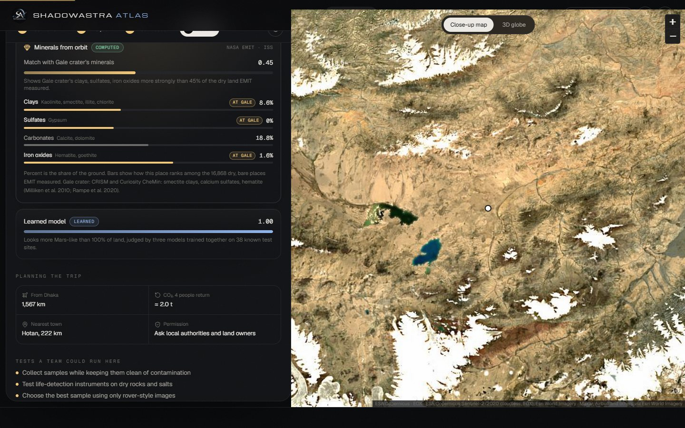
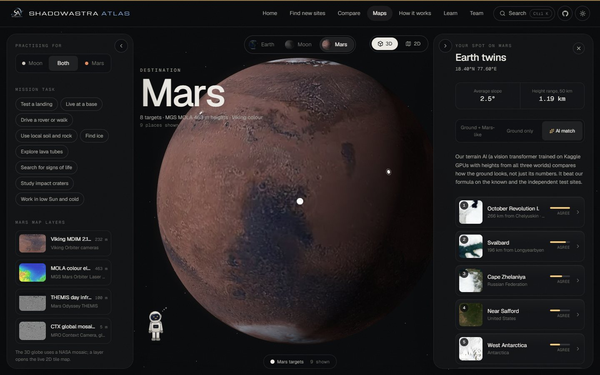
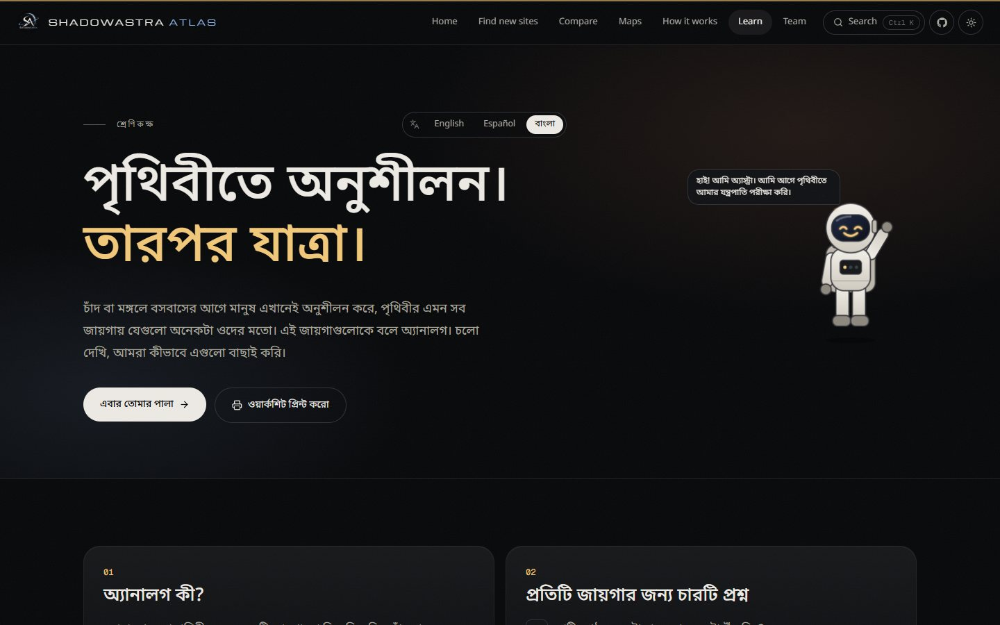
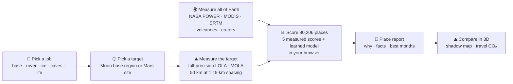

<p align="center">
  <a href="https://shadowastra-atlas.vercel.app">
    
  </a>
</p>

<p align="center">
  <a href="https://shadowastra-atlas.vercel.app"></a>
  <a href="https://www.spaceappschallenge.org/2026/challenges/identify-earth-locations-that-analog-the-permanent-moon-base-locations-and-mars/"></a>
  <a href="https://huggingface.co/datasets/ABRUBAB/shadowastra-atlas"></a>
</p>
<p align="center">
  
  
  
  
  
  
</p>

<p align="center">
  <b>Where on Earth can we practise for a Moon base or a Mars mission?</b><br/>
  ShadowAstra Atlas measures every land area on Earth with open NASA data, compares it with Moon and Mars places<br/>
  at the same scale, ranks the whole planet for the job you pick, and says plainly what Earth can never copy.
</p>

<p align="center">
  <a href="https://shadowastra-atlas.vercel.app"><b>Open the live site</b></a> ·
  <a href="https://shadowastra-atlas.vercel.app/discover"><b>Find new sites</b></a> ·
  <a href="https://shadowastra-atlas.vercel.app/lab"><b>Compare in 3D</b></a> ·
  <a href="pipeline/README.md"><b>Data pipeline</b></a> ·
  <a href="https://huggingface.co/datasets/ABRUBAB/shadowastra-atlas"><b>Open dataset</b></a> ·
  <a href="#-team-shadowastra"><b>Team</b></a>
</p>

---

<p align="center">
  
</p>

## 🌑 The challenge

> *“Places on Earth that have analogous characteristics to the Moon or Mars allow mission teams to test equipment and methods before they fly; however, such terrestrial analog sites are not entirely well characterized. Your challenge is to use open Earth, Moon, and Mars data from NASA and other space agencies to identify and characterize new terrestrial analogs.”*
> NASA Space Apps Challenge 2026, **Identify Earth Locations that Analog the Permanent Moon Base Locations and Mars**

Famous analogs such as Atacama, Haughton Crater and Death Valley were chosen by reputation and access. A place can **look** like Mars and still be the wrong place to test a rover. So we did the opposite of picking by eye: **we measured all of Earth's land the same way, and let the mission decide.**

## 📊 In numbers

| | |
|---|---|
| **80,206** | land areas measured (every 0.5° cell, about 55 km wide) |
| **24** | measurements per place: slopes, height range, roughness, cold nights, hot days, rain, humidity, plants, snow, bare ground, volcanoes, craters…, plus NASA EMIT minerals for 16,868 dry places |
| **18** | Moon and Mars targets measured at full precision (LRO LOLA 118 m, MGS MOLA 463 m) |
| **38 + 28** | known analog sites to teach and test the model, plus 28 published sites kept out of training as an untouched test |
| **top 1.2%** | where hidden known sites rank for the learned model (Moon 0.5%, Mars 2.4%; each site and its neighbours within 300 km hidden, model retrained) |
| **top 17.8%** | where the 28 never-seen sites rank as the site scores them (Moon sites: top 7%); a simple rule manages top 40% |
| **78%** | of 78 sites rank higher when scored for the job they were really used for (sign test p < 0.001) |
| **9 of 10** | top places that stay put when every weight shifts by ±25% |
| **3 worlds** | Earth, Moon and Mars heights taught one terrain AI (a vision transformer, 2 × T4 GPUs on Kaggle) |

## ✨ What you can do

| | Feature | What it does |
|---|---|---|
| 🌍 | **Find new sites** | A mission builder: pick a Moon or Mars destination, the job (landing, base life, rover drive, ice, lava tubes, life search, craters, low Sun) and your team's needs in plain words (how far from home, near a town, altitude, month). All 80,206 land areas are searched live; you get ten distinct new places with satellite views, reasons and hints about which rule hides better sites. |
| ⚖️ | **Compare up to four** | Pick results and see them side by side: the four factors, measured values, rock type, distance, trip CO₂ and confidence. |
| 🪐 | **Earth twins of any spot** | Tap anywhere on the Moon or Mars. Kaggle-measured LOLA and MOLA ground is compared with every place on Earth, by our formula or by **a terrain AI** (a vision transformer trained on Kaggle GPUs with heights from all three worlds). |
| 💎 | **Minerals from orbit** | Every place report shows what NASA's EMIT spectrometer sees in the ground (clays, sulfates, carbonates, iron oxides) next to the minerals orbiters and rovers found at Jezero, Gale, Meridiani and Mawrth Vallis. |
| 🌡️ | **Both sides measured** | Reports put NASA numbers on the Moon and Mars side too, for all 18 targets: LRO Diviner ground temperatures (stable ice at the south pole, the full day and night elsewhere), Lunar Prospector iron and titanium, Mars Odyssey water in the topsoil. |
| 🎯 | **Best 10 km spot** | Each 55 km place is cut into 10 km pieces; the one whose slopes are most like the target's is drawn on the close-up map. We tested it on 66 real field sites and say plainly that it is a hint, not a prediction. |
| 🎓 | **Learn, in English, Spanish or Bangla** | Short lessons, a quiz scored with real data, and a printable worksheet for classrooms. |
| 📄 | **Site report** | A printable one-page dossier for any place: the four factors and minerals on Earth and the target, field tests, planning, permission and what Earth can't copy. |
| 📍 | **Check your town** | Type any town. See how Moon-like and Mars-like it is, its real climate numbers, and the nearest strong practice site. |
| ⛰️ | **Compare in 3D** | Any Earth place next to its Moon or Mars target: real heights, real imagery, a movable Sun, a shadow map, best months to go and travel CO₂. |
| 🎮 | **Earth or Mars?** | A game with real orbital images of known look-alike pairs, same scale, colour off. |
| 🧑‍🚀 | **Astra** | Our field-test astronaut shivers in the cold, sweats in the heat, cheers good matches and answers questions from the real data. |
| 🏷️ | **Honest labels** | Every value is **Computed**, **Learned** or **Earth can't copy**, and every place has a confidence badge (real measurements and model agreement); thin evidence says **Not enough evidence**. |
| ⌨️ | **Search everything** | `Ctrl K` or `/` searches pages, Moon and Mars places, known sites and any town on Earth. |
| ♿ | **For everyone** | Dark and light themes checked for WCAG 2.2 AA contrast, a "Pause motion" switch, the system reduce-motion setting respected, still images where 3D is not available. |

## 🔭 Tour

<table>
  <tr>
    <td width="50%"><br/><sub><b>Place report.</b> Why a place scores for the job, its four factors next to the target with real Moon or Mars numbers, confidence and a close-up map.</sub></td>
    <td width="50%"><br/><sub><b>Minerals from orbit.</b> NASA EMIT sees Gale crater's clays, sulfates and iron oxides in the Altun Mountains.</sub></td>
  </tr>
  <tr>
    <td><br/><sub><b>Compare.</b> The Atacama next to Gale crater at the same metres per pixel. Every score row is measured.</sub></td>
    <td><br/><sub><b>AI twins.</b> Tap Jezero crater; the terrain AI finds Svalbard and the Atacama, two real Mars analogs, plus new candidates.</sub></td>
  </tr>
  <tr>
    <td><br/><sub><b>Every new dataset is tested.</b> Terrain AI, EMIT minerals, Diviner and Odyssey on How it works, with what helped and what did not.</sub></td>
    <td><br/><sub><b>Light mode.</b> A warm paper theme with its own colours. Space scenes stay dark.</sub></td>
  </tr>
  <tr>
    <td><br/><sub><b>Learn.</b> Lessons, a live quiz and a worksheet in English, Spanish and বাংলা.</sub></td>
    <td><br/><sub><b>Check your town.</b> Dhaka: green and wet, 2,071 mm of rain a year. Astra points to the nearest strong site instead.</sub></td>
  </tr>
  <tr>
    <td><br/><sub><b>Earth or Mars?</b> Real Sentinel-2, Viking and LROC images of known look-alike pairs.</sub></td>
    <td><br/><sub><b>Meet Astra.</b> Ten reactions and a field log of badges you earn by exploring.</sub></td>
  </tr>
</table>

## ⚙️ How it works



### The match score

| Part | How it is measured | Data |
|---|---|---|
| **Ground shape** | `0.65 · overlap(slope histograms) + 0.35 · height-range agreement`, same 50 km grid on both worlds | SRTM terrain tiles vs LOLA / MOLA |
| **Rocks & craters** | volcano and impact-crater proximity plus bare rock, depending on the job | Smithsonian GVP, Earth Impact Database, MODIS land cover |
| **Cold & heat** | coldest monthly night and the day-to-night swing (ice jobs add snow and ice) | MODIS land surface temperature, NASA POWER |
| **Sunlight angle** | `1 − W₁(Sun heights) / 25°`, earth-mover distance in Earth's best month | our solar geometry |
| **Bare, dry ground** | little rain and few plants | NASA POWER rain, MODIS NDVI |
| **Learned model** | a rank-average of tuned XGBoost, tuned LightGBM and logistic regression, trained on 38 known sites (positive-unlabelled, 8 bags), picked from nine models on Kaggle; 60% of the total by default (you can choose 30% or 90%) | all of the above, plus GLiM rock groups |
| Gravity · Air · Radiation | shown next to every score, never added in | Earth can't copy |

Total = `(1 − m) · Σ wᵢ·vᵢ / Σ wᵢ + m · model`, with weights `wᵢ` from the job. Every slider re-ranks the planet live.

### A fair test

For every known test site we hid it **and every other known site within 300 km**, retrained the model, and checked where the hidden site ranked among all 80,206 places. Then we checked **28 more published sites that were never used for anything** (Austrian Space Forum, ISRO HOPE, Europlanet, NASA teams, Apollo training). `pipeline/s14_validate.py` reruns all of it from the website's own data files.

| | Learned model | What the site shows (60% model) | Mission factors only | Simple rule |
|---|---|---|---|---|
| Hidden known sites, typical rank | top 1.2% | **top 2.4%** | top 19% | top 31 to 35% |
| 28 never-seen sites, typical rank | top 15% | **top 18%** | top 41% | top 40% |
| Never-seen Moon sites | top 0.8% | **top 7.2%** | top 48% | top 36% |

More tests: choosing the job a site was really used for ranks it higher for 78% of 78 sites (p < 0.001); shifting every weight by ±25% keeps 9 or 10 of the top 10 places; taking out *Rocks & craters* hurts most. The known sites alone would let the model count for 90%; we keep 60% so your target and job still shape the list.

**New data has to earn its place.** It only changes the score if it ranks the known sites better:
- **Terrain AI (Kaggle K3).** For ground shape alone it beats our formula on the known sites (top 44% vs 62%) and the never-seen sites (58% vs 71%), and ties on expert pairs. In the full score it adds nothing (known sites 2.8% vs 2.4%), so it powers the AI twin finder and is an option in Find, not the default.
- **NASA EMIT minerals.** As a model input they did not help where EMIT can see (1.6% → 1.8%). As a Mars mineral match in Rocks & craters they helped the never-seen Mars sites (41% → 38%) but not the known ones (22.4% → 22.8%), so they are shown as measured facts, not scored. Honest limits: the mission factors alone find known sites only about as well as a simple rule, because many analog sites were chosen for something smaller than our 55 km cells (an ice cave, a small lake, hot springs). Their job is to explain why a place matches and to tune it to your target and job; the learned model finds them. The How it works page shows where it fails and why.

## 🛰️ Open data

| World | Data | Used for | From |
|---|---|---|---|
| 🌍 Earth | POWER climatology (MERRA-2) | air temperature, coldest and hottest months, rain, humidity, sunshine | NASA LaRC |
| 🌍 Earth | MODIS land surface temperature, NDVI, snow, land cover | night cold, day heat, plants, snow months, bare ground | NASA GIBS |
| 🌍 Earth | SRTM elevation (Terrain Tiles) | slopes, height range, roughness; 3D ground | NASA SRTM via AWS Open Data |
| 🌍 Earth | Holocene volcanoes · impact craters · place names | rocks score, report facts, readable names | Smithsonian GVP · Earth Impact Database · Natural Earth |
| 🌍 Earth | Sentinel-2 cloudless 2020 · Blue Marble · ASTER | imagery, 3D drape, globe, game | ESA Copernicus via EOX · NASA GIBS |
| 🌕 Moon | LRO LOLA global DEM (16-bit, 118 m) · LROC WAC | target terrain at full precision; maps, 3D, game | USGS Astrogeology · NASA Solar System Treks |
| 🔴 Mars | MGS MOLA global DEM (16-bit, 463 m) · Viking MDIM · THEMIS | target terrain at full precision; maps, 3D, game | USGS Astrogeology · NASA Solar System Treks |
| 🌍 Earth | EMIT L3 Aggregated Mineral Spectral Abundance 0.5° | clays, sulfates, carbonates and iron oxides in dry, bare land | NASA JPL · LP DAAC (Earthdata) |
| 🌕 Moon | LRO Diviner polar resource product | ground temperatures and stable water ice around the south-pole targets | NASA · UCLA · PDS Geosciences |
| 🔴 Mars | Mars Odyssey GRS 5° water map | water in the topsoil at each Mars target | NASA · U. Arizona · PDS Geosciences |
| 🪐 All | Kaggle K1, K3, K5 | Moon and Mars measured everywhere; terrain AI; nine-model comparison | our notebooks on Kaggle (2 × T4) |

**Open dataset.** Every place, every target score, the AI twins and every test are on Hugging Face under CC BY 4.0: [ABRUBAB/shadowastra-atlas](https://huggingface.co/datasets/ABRUBAB/shadowastra-atlas) (`pipeline/s21_open_dataset.py` rebuilds it).

**Next:** the official 2026 challenge datasets (released 28 Oct), NASADEM, MRO HiRISE, ESA HRSC. The [pipeline](pipeline/README.md) is built so each new source is one script.

<details>
<summary><b>🏆 How we cover every award category</b></summary>

| Award | Where to see it |
|---|---|
| Best Use of Science | Every land area measured the same way as the target, at the same scale; a model tested by hiding known sites |
| Best Use of Data | NASA POWER, MODIS, SRTM, full-precision LOLA and MOLA, volcano and crater records in one open global dataset |
| Best Use of Technology | 80,206 places re-ranked live in the browser, 3D score globe, WebGL terrain from real heights, shadow model |
| Galactic Impact | Tells field teams where and when to practise, and what the practice can't prove |
| Best Mission Concept | Pick a job and a destination; the whole planet answers with places, reasons and best months |
| Most Inspirational | Astra reacts to cold, heat and honest results; anyone can check their own town |
| Best Storytelling | Earth to Moon to Mars, “looks alike is not enough”, light and shadow |
| Global Connection | Check any town on Earth; find the closest strong site from any city |
| Art & Technology | NASA-mosaic globes, a sunlight-and-shadow palette, light and dark themes |
| Local Impact | Dhaka as the default home city; a classroom page in Bangla, Spanish and English |

</details>

## 🌱 Sustainability & stewardship

- **Fewer trips.** Screen the whole planet remotely and fly only to the shortlist. Compare shows each trip's distance and rough CO₂.
- **Closest credible site.** The default home city is Dhaka; any team can choose its own.
- **Consent before coordinates.** Antarctic Treaty areas, national parks, sacred and Indigenous land are flagged.

## 🧪 Run it locally

```bash
npm install
npm run dev          # http://localhost:3000
npm run build        # production build in dist/
npm run typecheck    # TypeScript, strict
npm test             # 67 unit, data and Python-parity tests
npm run test:e2e     # browser tests and accessibility scans on the production build
```

Tests, benchmarks, security and reliability checks, with measured numbers: [`docs/ENGINEERING.md`](docs/ENGINEERING.md). CI runs on every push (`.github/workflows/ci.yml`); the live site is smoke-tested after each deploy and every six hours.

Requires Node 20+. To rebuild the global data from scratch see [`pipeline/README.md`](pipeline/README.md) (Python 3; only the EMIT step needs a free NASA Earthdata token).

**Handy links:** `?theme=light` · `?splash=0` skips the intro · `/discover?target=shackleton&task=polar` · `/discover?at=23.81,90.41` opens a place report · `/lab?earth=@21.25,17.75&target=jezero` compares any coordinates.

## 🚀 Deploy

Deployed on **Vercel** at [shadowastra-atlas.vercel.app](https://shadowastra-atlas.vercel.app). Vite build, output `dist`, every push to `main` redeploys. It is a static site: **no backend server and no database**. The measured planet ships as versioned files in `public/data/`, every score is computed in the visitor's browser, and map tiles come straight from NASA, ESA, Esri and AWS. Security headers and the content security policy are in `vercel.json`.

## 🧱 Tech

React 19 · TypeScript · Vite · Tailwind CSS v4 · three.js + React Three Fiber · Leaflet · GSAP · Lenis · Motion · Python (NumPy, SciPy, LightGBM, XGBoost, scikit-learn) for the data pipeline · PyTorch (DINO ViT) on Kaggle

**Performance:** the global dataset is 5.0 MB of typed arrays (2.3 MB with Brotli); scoring all 80,206 places takes 16 ms (p50) and 19 ms (p95) on an AMD Ryzen 5 5600H laptop, and a whole search with ranking and hints 27 ms; the terrain AI layer (1.4 MB) loads only when chosen; WebP textures in 1K, 2K and 4K; lazy routes and idle prefetch; slow or software graphics get a lighter mode automatically.

```
pipeline/      Python: download, measure, model and test all of Earth (s01 to s24)
kaggle/        GPU and CPU notebooks run on Kaggle (K1 to K5) and their runner
public/data/   grid.bin + grid.json (the measured planet), validation.json (every test), shape.bin (terrain AI), terrain/ (Moon and Mars bands, AI twins)
src/
  lib/         grid (load, score, rank, search) · terrain · sun · scoring · astra
  components/  three (score globe, terrain slabs) · map · ui kit · Astra · game · town check
  pages/       Home · Discover · Lab (Compare) · Atlas (Maps) · Methods · Learn · About
```

## 🗺️ Roadmap

- [x] Live NASA maps for three worlds, 3D globes, lunar south-pole map
- [x] Compare in 3D: matched scale, terrain, shadow map, best months, travel CO₂
- [x] Every land area on Earth measured; full-precision LOLA and MOLA targets
- [x] Learned model with a spatial hold-out test
- [x] Find new sites, town checker, game, badges, search, Astra's live answers
- [x] Terrain encoder, first test: a self-supervised CNN on 86,000 height patches from all three worlds; it lost to the formula, which led to K3
- [x] Mission builder, compare up to four, Earth twins of any Moon or Mars spot, Learn page in English, Spanish and Bangla
- [x] Independent validation on 28 published sites, model-share curve, job test, robustness and ablations
- [x] Kaggle K1: full-precision LOLA and MOLA measured everywhere; K2: Earth patches; K5: model zoo with Optuna
- [x] Kaggle K3: a self-supervised terrain transformer for three worlds on 2 × T4, tested and shipped as AI twins and an option in Find
- [x] Sharper imagery as you zoom (Esri on Earth, CTX on Mars, Kaguya on the Moon), close-up map of each result
- [x] K5 ensemble as the site model; EMIT minerals, Diviner temperatures and ice, Odyssey water, each tested before it counts
- [x] Engineering pass: memory leaks fixed, faster clicks, security headers, error fallbacks, WCAG 2.2 fixes, unit, parity and browser tests, CI and uptime checks
- [x] Best 10 km spot inside each place (tested on 66 field sites); Diviner and Lunar Prospector facts for every Moon target; expert review kit
- [ ] Official 2026 challenge datasets (released 28 Oct)
- [ ] Expert review of the top 20 by Md. Tanvir Hasan; Mars SWIM ice when its site is back

## 👩‍🚀 Team ShadowAstra

<table>
  <tr>
    <td align="center" width="16%"><br/><b>Abdullah Rubab</b><br/><sub>Team lead</sub></td>
    <td align="center" width="16%"><br/><b>Tanvir Hossin</b><br/><sub>Planetary terrain research</sub></td>
    <td align="center" width="16%"><br/><b>Md. Tanvir Hasan</b><br/><sub>Scientific validation</sub></td>
    <td align="center" width="16%"><br/><b>Mohammad Saniul Alam</b><br/><sub>Experience design</sub></td>
    <td align="center" width="16%"><br/><b>Tasnuva Arif</b><br/><sub>Development & testing</sub></td>
    <td align="center" width="16%"><br/><b>Mohammed Mahmud Parvez</b><br/><sub>Film editing</sub></td>
  </tr>
</table>

<p align="center"><sub>Made in Dhaka, Bangladesh 🇧🇩 for the 2026 NASA Space Apps Challenge.</sub></p>

## 📜 Credits & license

Data: NASA POWER (LaRC); NASA GIBS / ESDIS; NASA EMIT (JPL, LP DAAC); NASA Solar System Treks (JPL); USGS Astrogeology; PDS Geosciences; LRO (LROC, LOLA, Diviner), MGS MOLA, Viking, Mars Odyssey (THEMIS, GRS), Terra MODIS & ASTER, Suomi NPP VIIRS; SRTM via AWS Terrain Tiles; Smithsonian Global Volcanism Program; Earth Impact Database (PASSC); Natural Earth; Sentinel-2 cloudless by EOX IT Services GmbH (contains modified Copernicus Sentinel data 2020, CC BY-NC-SA 4.0).

NASA does not endorse this project. The 8-bit Trek elevation used for the 3D view is our own calibration (scores use the 16-bit USGS data), CO₂ numbers are rough estimates and site coordinates are approximate. Field visits need permission, local partners and care for the land.

Code is released under the [MIT License](LICENSE).
