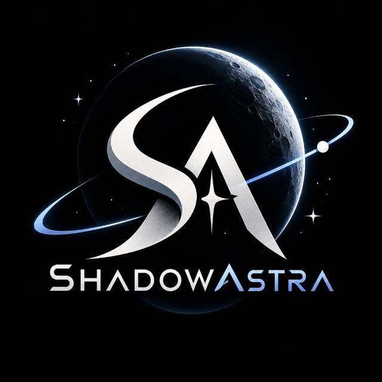

<p align="center">
  
</p>

<h1 align="center">ShadowAstra Atlas</h1>

<p align="center">
  <b>Rehearse other worlds on this one.</b><br/>
  Find the Earth landscapes where crews, rovers and instruments can practise for a permanent Moon base and for Mars, using open NASA data.
</p>

<p align="center">
  NASA Space Apps Challenge 2026 · Team <b>ShadowAstra</b> · Dhaka, Bangladesh<br/>
  Challenge: <a href="https://www.spaceappschallenge.org/2026/challenges/identify-earth-locations-that-analog-the-permanent-moon-base-locations-and-mars/"><i>Identify Earth Locations that Analog the Permanent Moon Base Locations and Mars</i></a>
</p>

---

> **Status: preliminary-round prototype (v0.1).** This repository shows the progress we made before the hackathon: the interface, real NASA map layers for all three worlds, the reference catalogue, and matched-scale comparison. The scientific screening pipeline and our trained model are planned for the hackathon weekend (see [docs/PROJECT_PLAN.md](docs/PROJECT_PLAN.md)). Site ratings in the app are a literature-informed prototype and are labelled as such. They are not model output.

## The challenge

Selecting future landing sites and lunar base locations depends on topography, geology, environment and resources. Earth places such as the Atacama Desert, Haughton Crater and Death Valley let mission teams test equipment and methods before they fly. These sites are **not well characterized**, though. NASA asks teams to use open Earth, Moon and Mars data from NASA and other space agencies to **identify and characterize new terrestrial analogs** for future bases and landing sites.

## Our approach

We start from the mission, not from the picture. A site that *looks* like Mars can be the wrong place to rehearse a specific task. We call this a "false friend".

1. **Mission task.** Pick what you need to rehearse: base operations, rover traverse, ISRU, ice prospecting, lava tubes, astrobiology, impact geology or polar light.
2. **Target region.** Choose a permanent Moon base region (Artemis south-pole candidates) or a Mars target.
3. **Evidence layers.** Compare topography, geology, environment and resources with NASA data at a **matched physical scale**.
4. **Earth shortlist.** Known analogs act as calibration controls. New regions are screened against them.
5. **Site passport.** The passport covers what to test, what Earth cannot reproduce (gravity, vacuum, radiation), permits and stewardship.

## What is built (preliminary round)

| Feature | Status |
|---|---|
| Cinematic landing page with a 3D Earth, Moon and Mars built from NASA mosaics | ✅ |
| **Atlas**: 3D globes plus 2D tile maps for Earth, Moon and Mars, filtered by world and mission task | ✅ |
| **12 live NASA map layers** (GIBS and Solar System Treks) | ✅ |
| **Lunar south pole map**, reprojected from LRO LOLA to polar stereographic | ✅ |
| **Compare**: side-by-side and swipe views, with scale locked to equal metres per pixel using each body's radius | ✅ |
| Catalogue: 17 reference Earth analogs, 18 Moon/Mars targets, 8 mission tasks, 8 regions queued for new-analog screening | ✅ |
| Data & Method page with a source registry (NASA, ESA, JAXA, ISRO) | ✅ |
| DEM feature pipeline, baseline ranker, trained terrain encoder, site passport export | ⏳ hackathon |

## NASA data used

All imagery is streamed live from NASA services or derived from them with the scripts in [`scripts/`](scripts). We did not paint or AI-generate any of it.

| World | Layer | Instrument / product | Service |
|---|---|---|---|
| Earth | Blue Marble shaded relief | MODIS composite + SRTM | NASA GIBS |
| Earth | True colour (daily) | Terra MODIS corrected reflectance | NASA GIBS |
| Earth | Terrain hillshade | ASTER GDEM (30 m) | NASA GIBS |
| Earth | Land surface temperature | Terra MODIS LST | NASA GIBS |
| Earth | Night lights | Suomi NPP VIIRS Black Marble | NASA GIBS |
| Moon | Global mosaic | LRO LROC WAC (303 ppd) | NASA Trek |
| Moon | Colour elevation, hillshade | LRO LOLA | NASA Trek |
| Moon | South pole (polar stereographic) | LRO LOLA hillshade, reprojected by us | NASA Trek → `scripts/build_textures.py` |
| Mars | Global colour mosaic | Viking MDIM 2.1 | NASA Trek |
| Mars | Colour elevation | MGS MOLA | NASA Trek |
| Mars | Day infrared | Mars Odyssey THEMIS | NASA Trek |

The 3D globe textures come from GIBS WMS (Blue Marble, Black Marble) and stitched Trek tiles (LRO WAC, Viking MDIM). Site thumbnails are NASA Blue Marble crops. Run `npm run textures` and `python scripts/build_thumbs.py` to rebuild them.

## Run it locally

```bash
npm install
npm run dev        # http://localhost:5173
npm run build      # production build in dist/
```

Requirements: Node 20+. Python 3 with Pillow and NumPy is needed only to rebuild the textures.

## Tech

React 19 · TypeScript · Vite · Tailwind CSS v4 · three.js with React Three Fiber and drei (globes) · Leaflet (NASA tile maps, with an EPSG:4326 grid for Trek) · GSAP ScrollTrigger and SplitText with Lenis (landing story) · Motion (UI transitions).

## Project structure

```
src/
  data/sites.ts        Earth analogs, Moon/Mars targets, tasks, screening regions
  data/layers.ts       NASA map layer catalogue (GIBS + Trek)
  lib/geo.ts           projections, body radii, matched-scale maths
  components/three/    Planet shader (day/night, atmosphere), hero scene, globe view
  components/map/      BodyMap: one Leaflet map for Earth, Moon, Mars and the lunar pole
  pages/               Home, Atlas, Compare, Methods
scripts/               reproducible NASA texture and thumbnail builders
docs/PROJECT_PLAN.md   full plan and roadmap
DESIGN.md              design system
```

## Team ShadowAstra

| Member | Role |
|---|---|
| Abdullah Rubab | Team Lead · Product & Integration |
| Tanvir Hossin | Planetary Data Research |
| Mohammad Saniul Alam | Geospatial Product Design |
| Tasnuva Arif | Development & Testing · Narrator |
| Md. Tanvir Hasan | Scientific Validation & Security |
| Mohammed Mahmud Parvez | Film & Motion |

## Credits and disclaimer

Imagery and data: NASA GIBS / ESDIS; NASA Solar System Treks (JPL); LRO (LROC, LOLA), MGS MOLA, Viking, Mars Odyssey THEMIS, Terra MODIS and ASTER, Suomi NPP VIIRS. NASA does not endorse this project. Analog site coordinates are approximate region centres for mapping, not for navigation. Field visits require permission, local partnership and environmental care.

Code is released under the MIT License. See [LICENSE](LICENSE).
