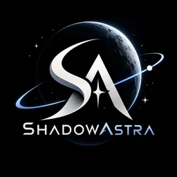

<p align="center">
  
</p>

<h1 align="center">ShadowAstra Atlas</h1>

<p align="center">
  <b>Rehearse other worlds on this one.</b><br/>
  Where on Earth to rehearse a permanent Moon base or a Mars mission, when to go, how close it is, and what the rehearsal can never prove.
</p>

<p align="center">
  NASA Space Apps Challenge 2026 · Team <b>ShadowAstra</b> · Dhaka, Bangladesh<br/>
  Challenge: <a href="https://www.spaceappschallenge.org/2026/challenges/identify-earth-locations-that-analog-the-permanent-moon-base-locations-and-mars/"><i>Identify Earth Locations that Analog the Permanent Moon Base Locations and Mars</i></a>
</p>

---

> **Status: preliminary-round prototype (v0.2).** Topography and lighting are **computed live from NASA elevation data and solar geometry**. Geology, temperature and regolith are **demo values**, labelled as such in the UI, until our model is trained at the hackathon. Radiation, gravity and atmosphere are shown as **reality gaps** and are never scored. Full plan: [docs/PROJECT_PLAN.md](docs/PROJECT_PLAN.md).

## What's new in our approach

1. **Mission-conditioned matching.** There is no universal "Mars-like" score. Weights change with the rehearsal task.
2. **Terrain Twins.** Real Earth (SRTM), Moon (LRO LOLA) and Mars (MGS MOLA) elevation on one shared grid, compared in 3D at the same scale.
3. **Shadow Lab.** A horizon-based illumination model turns a lunar-polar Sun around both terrains and maps ground that is never lit.
4. **Light Twin calendar.** Solar geometry picks the months when an Earth site's Sun angles best match the target.
5. **Rehearse closer.** The nearest credible analogs to your team's city, with distance and an indicative CO₂e estimate.
6. **Honest evidence.** Every value is tagged Computed, Demo or Reality gap.
7. **Astra.** Our field-test astronaut reacts to results: happy at a strong match, sad at a weak one.

## Pages

| Route | What it does |
|---|---|
| `/` | Ten-chapter story from Earth to Moon to Mars |
| `/atlas` | 3D globes and 12 live NASA map layers for three worlds, filtered by mission task |
| `/lab` | **Analog Lab**: side-by-side / swipe real-imagery comparison at matched scale + Analog Fit panel; below it real 3D terrain slabs with imagery drape, cross-section slice, slope stats, geology plates, Light & Shadow, rehearse-closer, reality gaps |
| `/methods` | Pipeline, scoring model and weights, source registry |
| `/about` | Team, the meaning of the name, award mapping, timeline |

## Open data used

| World | Product | Use | Service |
|---|---|---|---|
| Earth | Blue Marble · MODIS · ASTER GDEM · VIIRS Black Marble · MODIS LST | Maps, globe textures, thumbnails | NASA GIBS |
| Earth | SRTM-derived Terrain Tiles | Terrain slabs (elevation in metres) | AWS Open Data |
| Earth | Sentinel-2 cloudless 2020 (10 m) | Real-colour comparison, 3D drape, geology plates | ESA Copernicus via EOX (CC BY-NC-SA) |
| Moon | LRO LROC WAC, LOLA colour / hillshade / DEM | Maps, globe, south-pole map, Terrain Twins | NASA Solar System Treks |
| Mars | Viking MDIM 2.1, MGS MOLA colour / DEM, Odyssey THEMIS | Maps, globe, Terrain Twins | NASA Solar System Treks |

Planned for the pipeline: NASADEM, HLS, EMIT, LRO Diviner, MRO HiRISE / CTX / CRISM, ESA Copernicus DEM and HRSC, JAXA Kaguya, ISRO Chandrayaan-2.

Textures and thumbnails are rebuilt from NASA services with `npm run textures` and `python scripts/build_thumbs.py`. We did not paint or AI-generate any of them.

## Run locally

```bash
npm install
npm run dev        # http://localhost:5173
npm run build      # production build in dist/
```

Node 20+ is required. Python 3 with Pillow and NumPy is needed only to rebuild textures.

## Deploy on Vercel

1. Sign in at [vercel.com](https://vercel.com) with GitHub.
2. Click **Add New… → Project** and import `ABRUBAB/ShadowAstra_Atlas`.
3. Vercel detects **Vite**. Keep the defaults: build command `npm run build`, output directory `dist`, install command `npm install`.
4. Click **Deploy**. `vercel.json` already rewrites every route to `index.html`, so `/lab` and `/about` work on refresh.
5. Every push to `main` redeploys automatically.

## Tech

React 19 · TypeScript · Vite · Tailwind CSS v4 · three.js with React Three Fiber (globes, Terrain Twins) · Leaflet (NASA tiles, with an EPSG:4326 grid for Trek) · GSAP ScrollTrigger and SplitText with Lenis (story) · Motion (UI).

Performance: WebP textures in 1K, 2K and 4K levels (1K paints first and the sharper one streams in), a hero poster before WebGL, lazy routes and 3D, and idle-time prefetch.

## Structure

```
src/
  data/       sites, targets, tasks, screening regions · NASA layer catalogue
  lib/        geo (projections, scale) · terrain (DEM sampling, slopes, shadows)
              sun (Light Twin) · scoring (Analog Fit, weights, sustainability)
  components/ three (Planet, HeroScene, GlobeView, TerrainTwins) · map (BodyMap, Swipe)
              ui (Chrome, Astronaut)
  pages/      Home, Atlas, Lab, Methods, About
scripts/      reproducible NASA texture and thumbnail builders
docs/         PROJECT_PLAN.md
```

## Team ShadowAstra

| Member | Role |
|---|---|
| Abdullah Rubab | Team lead |
| Tanvir Hossin | Planetary terrain research |
| Mohammad Saniul Alam | Experience design |
| Tasnuva Arif | Development & testing |
| Md. Tanvir Hasan | Scientific validation |
| Mohammed Mahmud Parvez | Film editing |

## Credits and disclaimer

Data: NASA GIBS / ESDIS; Sentinel-2 cloudless — https://s2maps.eu by EOX IT Services GmbH (contains modified Copernicus Sentinel data 2020); NASA Solar System Treks (JPL); LRO (LROC, LOLA), MGS MOLA, Viking, Mars Odyssey THEMIS, Terra MODIS and ASTER, Suomi NPP VIIRS; SRTM via AWS Terrain Tiles. NASA does not endorse this project. The 8-bit Trek DEM calibrations are our own approximations. CO₂ figures are indicative. Coordinates are approximate region centres. Field visits require permission, local partnership and environmental care.

MIT License. See [LICENSE](LICENSE).
