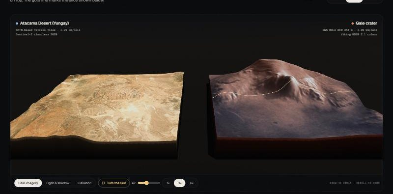
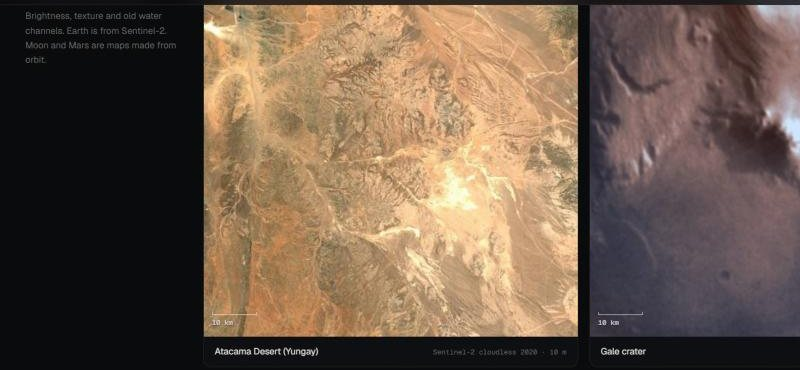
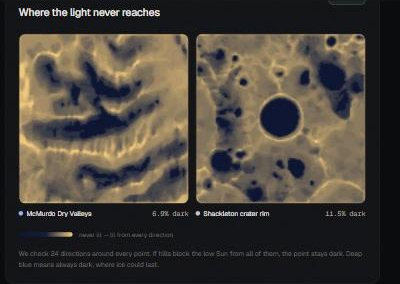
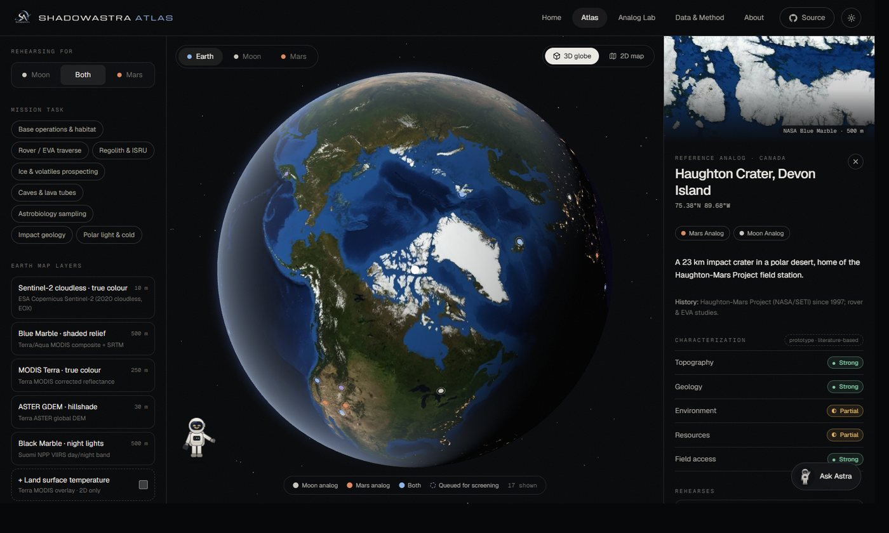
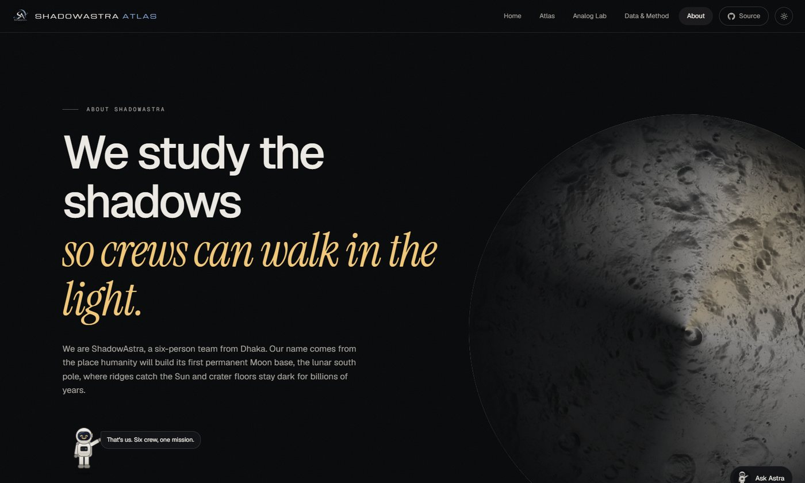
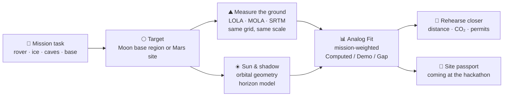

<p align="center">
  <a href="https://shadowastra-atlas.vercel.app">
    
  </a>
</p>

<p align="center">
  <a href="https://shadowastra-atlas.vercel.app"></a>
  <a href="https://www.spaceappschallenge.org/2026/challenges/identify-earth-locations-that-analog-the-permanent-moon-base-locations-and-mars/"></a>
</p>
<p align="center">
  
  
  
  
  
  
</p>

<p align="center">
  <b>Where on Earth can we practise for a Moon base or a Mars mission?</b><br/>
  ShadowAstra Atlas matches each mission task to real places on Earth, compares the ground at the same scale,<br/>
  checks the sunlight, and says plainly what Earth can never copy.
</p>

<p align="center">
  <a href="https://shadowastra-atlas.vercel.app"><b>Open the live site</b></a> ·
  <a href="https://shadowastra-atlas.vercel.app/lab"><b>Analog Lab</b></a> ·
  <a href="docs/PROJECT_PLAN.md"><b>Project plan</b></a> ·
  <a href="#-team-shadowastra"><b>Team</b></a>
</p>

---

<p align="center">
  
</p>

## 🌑 The challenge

> *“Places on Earth that have analogous characteristics to the Moon or Mars allow mission teams to test equipment and methods before they fly; however, such terrestrial analog sites are not entirely well characterized. Your challenge is to use open Earth, Moon, and Mars data from NASA and other space agencies to identify and characterize new terrestrial analogs.”*
> NASA Space Apps Challenge 2026, **Identify Earth Locations that Analog the Permanent Moon Base Locations and Mars**

Famous analogs such as Atacama, Haughton Crater and Death Valley are chosen by reputation. A place can **look** like Mars and still be the wrong place to test a rover. We call that a **false friend**, and ShadowAstra Atlas is built to catch it.

## ✨ What makes it different

| | Idea | What you can do |
|---|---|---|
| 🎯 | **Matched to the job** | Pick a task (rover driving, ice search, lava tubes, base life…). The score changes with the task. There is no single “Mars-like” number. |
| ⛰️ | **Terrain slabs** | See real Earth, Moon and Mars ground side by side in 3D, cut to the same size, with real satellite images on top. |
| 🌗 | **Shadow Lab** | Move a low lunar-polar Sun around both places and see which ground never gets light. That is where ice can hide. |
| 📅 | **Light Twin calendar** | Our Sun maths tells field teams which month on Earth has sunlight most like the target. |
| 🌱 | **Rehearse closer** | Find the nearest good site to your team’s city, with the distance and a rough CO₂ estimate. |
| 🏷️ | **Honest labels** | Every number is marked **Computed**, **Demo** or **Reality gap**. Gravity, vacuum and radiation are never hidden. |
| 🧑‍🚀 | **Ask Astra** | Our field-test astronaut answers questions from our own data, with no made-up facts. |

## 🔭 Tour

<table>
  <tr>
    <td width="50%"><br/><sub><b>Analog Lab: compare.</b> Sentinel-2 Atacama next to Viking Gale crater, locked to the same metres per pixel. Astra reacts to the score.</sub></td>
    <td width="50%"><br/><sub><b>Terrain slabs.</b> Real SRTM and MOLA elevation, real imagery on top, plus the gold slice line used for the cross-section.</sub></td>
  </tr>
  <tr>
    <td><br/><sub><b>Geology plates.</b> Same-size, north-up satellite crops of both worlds.</sub></td>
    <td><br/><sub><b>Shadow Lab.</b> Ground that never sees a low Sun (deep blue) on McMurdo Dry Valleys and Shackleton crater.</sub></td>
  </tr>
  <tr>
    <td><br/><sub><b>Atlas.</b> 3D globes and 13 live map layers for Earth, Moon and Mars.</sub></td>
    <td><br/><sub><b>Data &amp; Method.</b> Pipeline, scoring formulas, mission weights and a filterable source list.</sub></td>
  </tr>
  <tr>
    <td><br/><sub><b>Light mode.</b> A warm paper theme with its own colours. Space scenes stay dark.</sub></td>
    <td><br/><sub><b>About.</b> The real lunar south pole with a sweeping Sun: we study the shadows.</sub></td>
  </tr>
</table>

## 🧑‍🚀 Meet Astra


Astra is our field-test astronaut. His visor works like a screen and shows how he feels about the result:

- **Happy and jumping** when a place is a strong match (0.75 or more)
- **Thinking** when it is useful for some tests (0.50 to 0.74)
- **Sad** when a place will not copy the mission well
- **Scanning** while NASA terrain tiles load

Click **Ask Astra** on any page and ask things like *“Best Earth site for Gale crater?”*, *“Closest Mars analog to Dhaka”* or *“How is the score made?”*. Every answer is built from our catalogue, our Sun maths and our distance maths. There is no AI model and no internet lookup, so he cannot invent facts.

<br clear="right"/>

## ⚙️ How it works



### Analog Fit

| Part | How it is measured | Status |
|---|---|---|
| **Topography** | `0.65 · overlap(slope histograms) + 0.35 · relief agreement`, on one shared grid | ✅ Computed live |
| **Lighting** | `1 − W₁(sun elevations) / 25°`, using the earth-mover distance in the best season | ✅ Computed live |
| Geology · Temperature · Regolith | From published research for now, replaced by our model | 🟡 Demo |
| Radiation · Gravity · Atmosphere | Shown next to every score, never added in | 🔴 Reality gap |

Overall score = `Σ weightᵢ · valueᵢ / Σ weightᵢ`, where the weights come from the mission task. **0.75+** is a high match and **0.50 to 0.74** is medium.

## 🛰️ Open data

| World | Data | Used for | From |
|---|---|---|---|
| 🌍 Earth | Blue Marble · Black Marble · MODIS · ASTER GDEM · LST | Globe, maps, thumbnails | NASA GIBS |
| 🌍 Earth | SRTM elevation (Terrain Tiles) | 3D terrain, slopes, shadows | NASA SRTM via AWS Open Data |
| 🌍 Earth | Sentinel-2 cloudless 2020 (10 m) | True-colour comparison, 3D drape | ESA Copernicus via EOX |
| 🌕 Moon | LRO LROC WAC · LRO LOLA DEM & hillshade | Maps, globe, south-pole map, 3D terrain | NASA Solar System Treks |
| 🔴 Mars | Viking MDIM 2.1 · MGS MOLA DEM · Odyssey THEMIS | Maps, globe, 3D terrain, thermal plates | NASA Solar System Treks |

**Next in the pipeline:** NASADEM, HLS, EMIT, LRO Diviner, MRO HiRISE / CTX / CRISM, ESA Copernicus DEM and HRSC, JAXA Kaguya, ISRO Chandrayaan-2.

<details>
<summary><b>🏆 How we cover every award category</b></summary>

| Award | Where to see it |
|---|---|
| Best Use of Science | Mission-weighted scoring, same-scale terrain stats, shadow model, reality gaps |
| Best Use of Data | 13 live layers + LOLA, MOLA and SRTM elevation; every value tagged by source |
| Best Use of Technology | WebGL terrain slabs from real elevation, in-browser shadow maths, three-world GIS |
| Galactic Impact | Tells field teams where and when to practise, and what the practice can’t prove |
| Best Mission Concept | “What mission can we test here?” becomes a site passport with a best season |
| Most Inspirational | Astra shows the search succeed and fail, honestly |
| Best Storytelling | Earth → Moon → Mars, the false friend, light and shadow |
| Global Connection | Search analogs anywhere; Rehearse closer works from any city |
| Art & Technology | NASA-mosaic globes, sunlight-and-shadow palette, light and dark themes |
| Local Impact | Dhaka-first STEM workshops and a Bangla-friendly classroom mode (planned) |

</details>

## 🌱 Sustainability & stewardship

- **Fewer trips.** Screen sites remotely and fly only to the shortlist. The Lab shows each trip’s distance and rough CO₂.
- **Closest credible site.** The default home city is Dhaka; any team can choose its own.
- **Consent before coordinates.** Antarctic Treaty areas, national parks, sacred and Indigenous land are flagged on every site.

## 🧪 Run it locally

```bash
npm install
npm run dev          # http://localhost:5173
npm run build        # production build in dist/
```

Requires Node 20+. Python 3 with Pillow and NumPy is only needed to rebuild textures (`npm run textures`, `python scripts/build_thumbs.py`).

**Handy links:** `?theme=light` opens light mode · `?splash=0` skips the intro · `/lab#geology` jumps to a Lab section · `/lab?earth=atacama&target=gale&task=traverse` opens a pair.

## 🚀 Deploy

Deployed on **Vercel** at [shadowastra-atlas.vercel.app](https://shadowastra-atlas.vercel.app). The framework is Vite, the build command is `npm run build` and the output is `dist`. `vercel.json` sends every route to `index.html`, and every push to `main` redeploys.

## 🧱 Tech

React 19 · TypeScript · Vite · Tailwind CSS v4 · three.js + React Three Fiber · Leaflet · GSAP ScrollTrigger & SplitText · Lenis · Motion

**Performance:** WebP textures in 1K, 2K and 4K (1K paints first, then the sharper one streams in), a poster image before WebGL starts, lazy routes, idle-time prefetch, and no heavy 3D helper libraries.

```
src/
  data/        sites, Moon/Mars targets, tasks, screening regions, NASA layer list
  lib/         geo · terrain (elevation, slopes, shadows, imagery) · sun · scoring · astra
  components/  three (globes, terrain slabs) · map (Leaflet, swipe) · ui (Astra, splash, nav)
  pages/       Home · Atlas · Lab · Methods · About
scripts/       rebuild NASA textures and thumbnails
docs/          PROJECT_PLAN.md · readme assets
```

## 🗺️ Roadmap

- [x] Live NASA maps for three worlds, 3D globes, lunar south-pole map
- [x] Analog Lab: matched-scale comparison, terrain slabs, Shadow Lab, Light Twin, rehearse closer
- [x] Ask Astra, light mode, branded loading screen
- [ ] Full-precision elevation (LOLA 5–20 m polar, HiRISE 1 m, NASADEM 30 m)
- [ ] Geology, temperature and regolith from EMIT, Diviner, THEMIS and CRISM
- [ ] Physical baseline ranker, then our trained terrain model on Kaggle
- [ ] Screen the 8 queued regions for **new** analogs and export site passports

## 👩‍🚀 Team ShadowAstra

<table>
  <tr>
    <td align="center" width="16%"><br/><b>Abdullah Rubab</b><br/><sub>Team lead</sub></td>
    <td align="center" width="16%"><br/><b>Tanvir Hossin</b><br/><sub>Planetary terrain research</sub></td>
    <td align="center" width="16%"><br/><b>Md. Tanvir Hasan</b><br/><sub>Scientific validation</sub></td>
    <td align="center" width="16%"><br/><b>Mohammad Saniul Alam</b><br/><sub>Experience design</sub></td>
    <td align="center" width="16%"><br/><b>Tasnuva Arif</b><br/><sub>Development & testing</sub></td>
    <td align="center" width="16%"><br/><b>Mohammed Mahmud Parvez</b><br/><sub>Film editing</sub></td>
  </tr>
</table>

<p align="center"><sub>Made in Dhaka, Bangladesh 🇧🇩 for the 2026 NASA Space Apps Challenge.</sub></p>

## 📜 Credits & license

Data: NASA GIBS / ESDIS; NASA Solar System Treks (JPL); LRO (LROC, LOLA), MGS MOLA, Viking, Mars Odyssey THEMIS, Terra MODIS & ASTER, Suomi NPP VIIRS; SRTM via AWS Terrain Tiles; Sentinel-2 cloudless by EOX IT Services GmbH (contains modified Copernicus Sentinel data 2020, CC BY-NC-SA 4.0).

NASA does not endorse this project. The 8-bit Trek elevation calibrations are our own approximations, CO₂ numbers are rough estimates and site coordinates are approximate. Field visits need permission, local partners and care for the land.

Code is released under the [MIT License](LICENSE).
